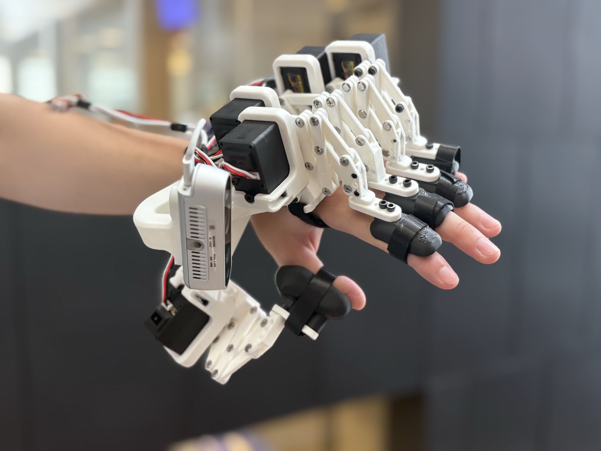
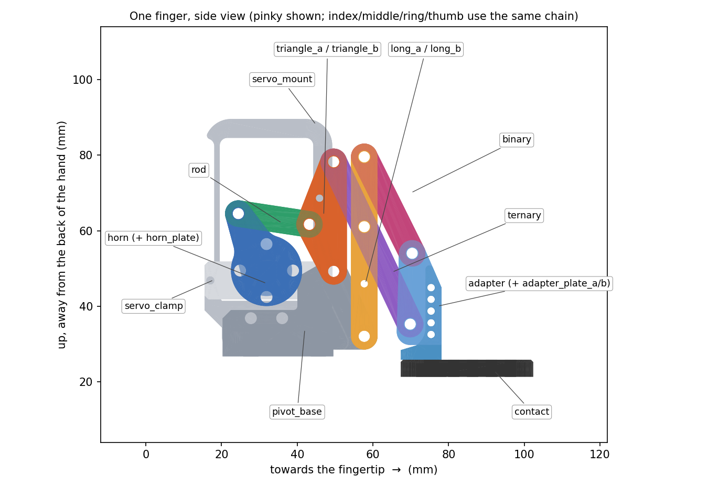
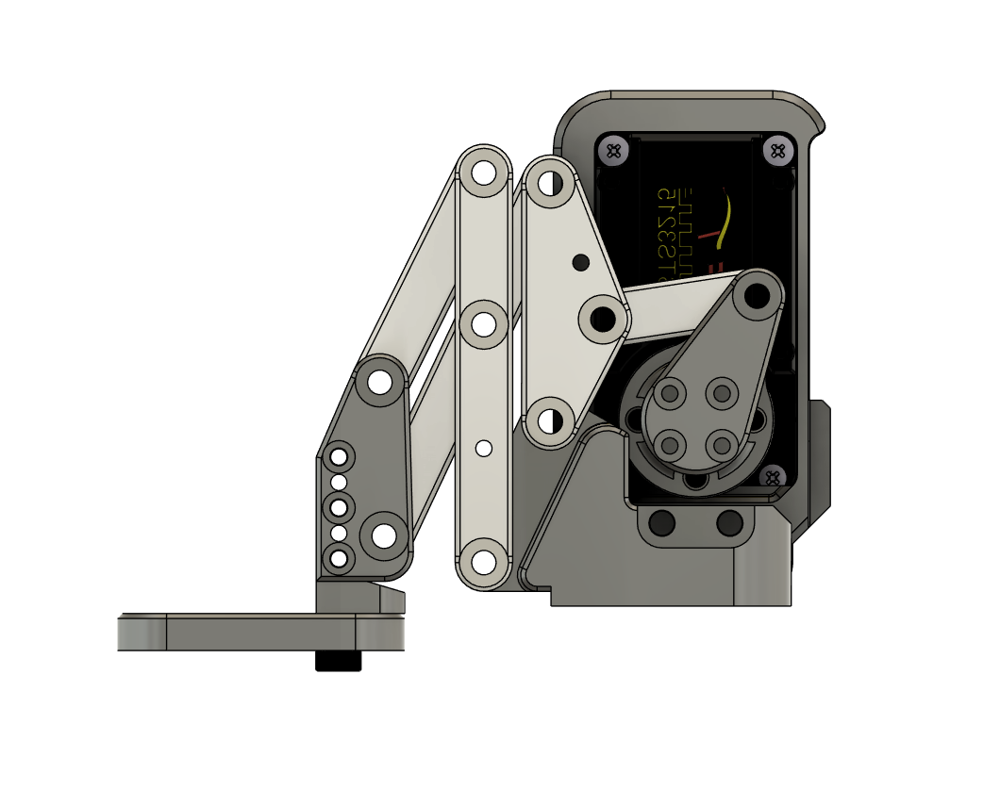
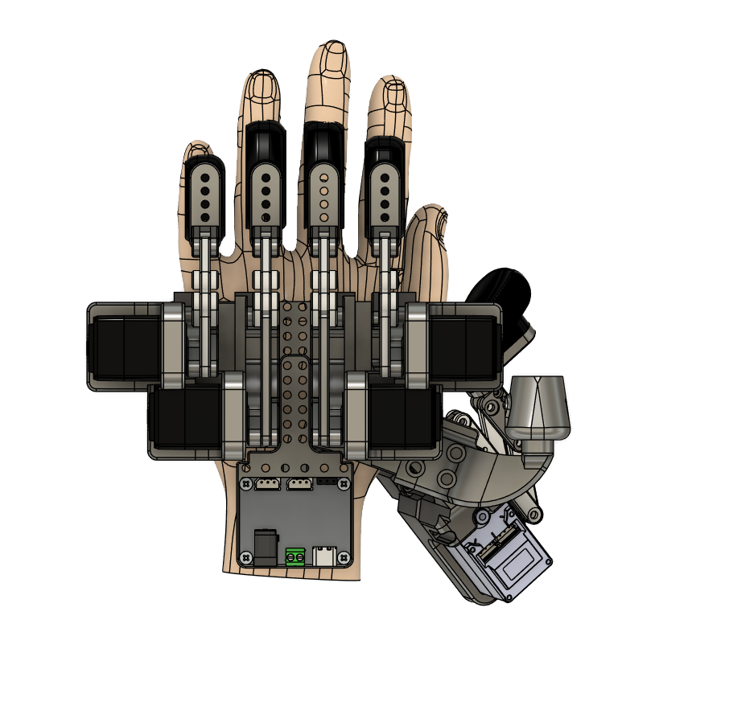
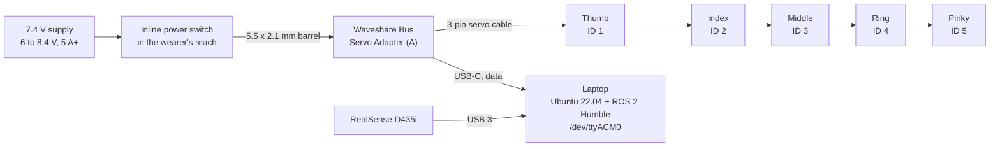

# Reflex hardware: CAD and build guide

Everything you need to build the Reflex exoskeleton hand: print files, the full CAD
assembly, a parts list, assembly steps, wiring, and the first power-on.



Reflex is a **left-hand** gauntlet. Five Feetech STS3215 bus servos sit on the back of
the hand, one per finger. Each servo drives a printed linkage that curls one finger
through a cap on the fingertip. A RealSense camera rides on the wrist. A USB servo
adapter connects everything to a laptop, so there is no microcontroller to flash.

> **This is a hackathon prototype, not a medical device.** The servos are strong
> enough to hurt a finger. Read [Safety](#safety) before you wear it.

## What is in this folder

| Path | What |
| --- | --- |
| [`cad/Reflex-left-hand.step`](cad/Reflex-left-hand.step) | Full assembly (printed parts, servos, adapter, camera, bearings, screws), in mm, as one STEP. Open it in any CAD tool. |
| [`cad/stl/`](cad/stl) | One STL per printed part, in mm, grouped by finger: `thumb/ index/ middle/ ring/ pinky/ base/` |
| [`images/`](images) | Renders, the labelled finger diagram, and the photo above |
| [`LICENSE`](LICENSE) | CERN-OHL-P v2 for the hardware design files in this folder |

The STLs come out of Fusion in each part's own frame, not where they sit on the
hand. Lay each one flat in your slicer. To see how the parts fit together, open the STEP.

## Parts

The bill of materials is in the
[Reflex BOM sheet](https://docs.google.com/spreadsheets/d/1V9WPKcL9JDbpGBQYDRUM5PvKsNWDA_8E0ONRpm72H6Q/edit?usp=sharing).
The base build is:

| Item | Qty | Notes |
| --- | --- | --- |
| Feetech **STS3215, 7.4 V** (C001, 1:345, 19.5 kg·cm) | 5 | One per finger. Get the 7.4 V version, not the 12 V one (see power below). |
| Waveshare Bus Servo Adapter (A) | 1 | USB to the servo bus. No MCU, nothing to flash. |
| Intel RealSense D435i | 1 | Wrist camera. Cheaper cameras are listed in the BOM. |
| 7.4 V power, 5 A or more | 1 | A 7.5 V DC adapter with a 5.5 × 2.1 mm center-positive plug, or a 2S LiPo. |
| Chicago screws (binding posts), M2 | 2 packs of 40 | One per linkage pivot: 9 per finger, 45 in total. |
| Ball bearing, 3 × 8 × 3 mm (MR83ZZ) | 5 | One in each fingertip pad. An M3 × 8 from the screw kit goes through it into the adapter. |
| M2.5 standoff kit | 1 | 4 screws and 4 hex standoffs hold the Waveshare adapter on the electronics plate. |
| Hook and loop (velcro) strap, 20 mm | ~1 m | Palm strap and one strap per finger cap |
| M4 socket head screw kit | 1 | M4 × 6, × 10 and × 16 hold the finger modules and thumb mount on the base plate (step 6). Get socket heads: the counterbores are 7.3 mm, too small for button heads. |
| M2 / M3 socket head screw kit | 1 | M2 and M3 screws for everything except the base, including the M3 × 8 for each fingertip bearing |

Not in the BOM sheet:

| Item | Where it goes |
| --- | --- |
| Inline DC power switch (5.5 × 2.1 mm), recommended | Between the supply and the adapter. See [Safety](#safety). |
| Filament: PLA for the finger caps | See printing for the other parts |

**Power: the servos are 7.4 V parts.** The Waveshare adapter passes its input straight
to the servos, so whatever you plug into it goes straight to the motors. Feed it
**6 to 8.4 V**. A 12 V supply or a 3S LiPo will damage 7.4 V servos. If you buy the 12 V
STS3215 instead, you need a 12 V supply. Never mix servo voltages on one bus.

## Printing

86 parts in total. Print every STL once:

| Folder | Parts | Includes |
| --- | --- | --- |
| `thumb/` | 16 | linkage, thumb `servo_mount`, `pivot_base`, `cap` |
| `index/` | 15 | linkage, `servo_mount`, `servo_clamp`, `pivot_base`, `cap`. The adapter is one merged part. |
| `middle/`, `ring/`, `pinky/` | 17 each | linkage, `servo_mount`, `servo_clamp`, `pivot_base`, `cap` |
| `base/` | 4 | `base_plate`, `electronics_plate`, `camera_mount`, `thumb_mount` |

- **Rigid parts** (everything except the caps): the build in the photo uses white
  filament. TODO(kevin): material, layer height, infill, walls, and which parts need supports.
- **Finger caps** (`*_cap.stl`): PLA.
- The `_a` / `_b` parts are the two side plates of the same link, one on each side
  of the finger. Print both.
- Total print time is about 8 hours on a typical FDM printer.

## How a finger works



Every finger is the same one-servo linkage. The thumb uses a different mount.

```text
servo horn --P-- rod --A-- triangle --B-- ternary --E-- adapter (+ contact pad + cap)
    |G0                       |G1             |M                |U
   servo                  pivot_base      long link --T-- binary
                                              |G2
                                          pivot_base
```

The servo turns the **horn**. The **rod** pushes the **triangle**, which pivots on
the **pivot_base**. The **ternary**, **long** and **binary** links carry the
motion out to the **adapter**, which curls the fingertip. The **contact** pad turns
on a bearing under the adapter, and the **cap** on the pad holds the wearer's
fingertip.



## Assembly

Do the servo setup (step 1) **before** any servo goes into the hand. A new STS3215
ships with ID 1, and two servos with the same ID cannot share the bus.

1. **Give each servo its ID.** Set up the software first (see
   [First power-on](#first-power-on), steps 1 and 2). Then connect **one servo at a time** and run:
   ```bash
   ros2 run htn_control servo_tool scan          # a new servo answers as ID 1
   ros2 run htn_control servo_tool set-id 1 2    # 2 = index; repeat with 3 middle, 4 ring, 5 pinky
   ```
   The thumb stays ID 1. Label each servo with its finger.
2. **Servos into their mounts.** Put each servo into its `servo_mount` (and
   `servo_clamp` for index to pinky) with the screws that come with the servo.
   Screw each `servo_mount` to its `pivot_base` with M3 screws: M3 × 10 from the
   `servo_mount` side and M3 × 16 from the `pivot_base` side. Fix each `servo_clamp`
   with M2 × 8 screws.
3. **Horns.** Screw each printed `horn` (and its `horn_plate`) to the round horn
   disc that comes with the servo, using the disc's four holes. The angle doesn't
   matter: calibration sets the open and closed positions later.
4. **Linkage.** Build each finger on its `pivot_base` as in the diagram above,
   with a Chicago screw through every moving joint (every pivot where two parts
   turn against each other): triangle and long link on the pivot_base (G1, G2),
   the rod from horn to triangle, the ternary and binary between the side plates,
   and the adapter (with `adapter_plate_a` and `_b`) on the end. Each finger should
   swing freely by hand before the servo is attached.
5. **Fingertip.** Press the bearing into the `contact` pad and screw it to the
   adapter with the M3 × 8. Screw the `cap` to the pad with two M3 × 8 screws
   (M3 × 6 on the thumb, whose pad is thinner).
6. **Onto the base.** Screw each finger's `pivot_base` to the `base_plate` with
   M4 × 6 screws from underneath, through the counterbored holes in the
   `base_plate`. Screw the `thumb_mount` to the `base_plate` the same way: M4 × 10
   in the two shallower holes, M4 × 16 in the two deeper ones. Fix the thumb
   `servo_mount` to the `thumb_mount` with two M2 × 10. See the top view below for
   placement. TODO(kevin): what goes through the four 4 mm holes that run through
   both the `thumb_mount` and the thumb `servo_mount` (about 37 mm long).
7. **Electronics.** Mount the Waveshare adapter on the `electronics_plate` with the
   M2.5 standoffs, then screw the plate to the `base_plate` with M3 × 12 screws.
8. **Camera.** Fix the RealSense to the `camera_mount` with two M3 × 6 screws in the
   threaded holes on its back. Don't go longer: those threads are only about 3 mm
   deep. Then fix the mount to the base.
9. **Straps.** Run a velcro strap around the palm, and one around each finger
   cap, as in the photo.



## Wiring



- The servos share one bus. Each STS3215 has two connectors, so chain them with
  the 3-pin cables that come with the servos. The order on the chain doesn't
  matter: the software finds each servo by its ID.
- Set the adapter's jumper to its USB mode (check the label on the board or the
  Waveshare wiki).
- Plug the RealSense into a USB 3 port. On USB 2 it works, but see the camera notes
  in [`physical_layer/CLAUDE.md`](../physical_layer/CLAUDE.md).

## First power-on

Do all of this with the hand **on the table, not on anyone's hand**.

1. **Install and build** (Ubuntu 22.04, ROS 2 Humble). From the repository root:
   ```bash
   ./physical_layer/build.sh
   source physical_layer/ros2_ws/install/setup.bash
   ```
2. **Serial access.** `sudo usermod -aG dialout $USER`, then log out and back in.
   The adapter shows up as `/dev/ttyACM0`.
3. **Check the bus.** `ros2 run htn_control servo_tool scan` should list IDs 1 to 5.
4. **Calibrate every finger before the first launch.** The `servos:` numbers in
   `physical_layer/ros2_ws/src/htn_description/config/hand_params.yaml` are from
   our build. Your horns sit at different angles, so those numbers would drive
   your fingers to the wrong places. Run `ros2 run htn_control servo_tool calibrate`
   (a window), then for each finger: pick it, move it open, **Set OPEN**, move it
   closed, **Set CLOSED**, **Save**. Save writes that finger's line in `hand_params.yaml`.
   Stop short of where the linkage locks up: about 10 to 25° of horn past closed
   and about 30° past open. The window warns you but does not stop you. On our
   build, the ring finger came within about 8° of a lock-up at both ends, which is
   the likely reason its plastic broke.
5. **Run it.**
   ```bash
   ros2 launch htn_launch hardware.launch.py serial_port:=/dev/ttyACM0
   ```
   In the control window, `Q W E R T` open the thumb to pinky and `A S D F G` close
   them. For the web console, run `./application/dev.sh` in a second terminal and open
   http://localhost:3000.

From here, the [main README](../README.md) covers the console, Claude/MCP control,
and the learned policy.

## Safety

- **Keep a power switch in the wearer's reach.** The servos hold their last target
  with no timeout. If the laptop or the USB link dies mid-move, cutting power is the
  only way to release them.
- Calibrate and test every finger **off** the hand first.
- Leave `torque_limit` in `hand_params.yaml` at its default (400 of 1000). At 700,
  parts of our hand broke.
- Never feed 7.4 V servos more than 8.4 V.
- The software clamps speed and travel. When a finger meets resistance, it drops
  that finger to a low holding force (the contact stop, in
  `docs/specs/hal-safety-design.md`). Neither replaces the power switch.

## Notes on the CAD

- This is the left hand. The Fusion file also holds a mirrored right hand that is
  still in progress. It is not exported here.
- The thumb sits differently in this CAD than in the hackathon build that
  `physical_layer/ros2_ws/src/htn_description` was generated from. If you
  regenerate the URDF, follow "New CAD export" in
  [`physical_layer/CLAUDE.md`](../physical_layer/CLAUDE.md).
- The servo, adapter, camera, bearing and screw models in the STEP are third-party
  vendor models, included for fit only. They are not covered by this folder's license.

## License

The hardware design files in `hardware/` (CAD, STL, drawings, this guide) are
licensed under the [CERN Open Hardware Licence v2, Permissive](LICENSE)
(CERN-OHL-P-2.0). The software in the rest of the repository is under the
[Apache License 2.0](../LICENSE).
